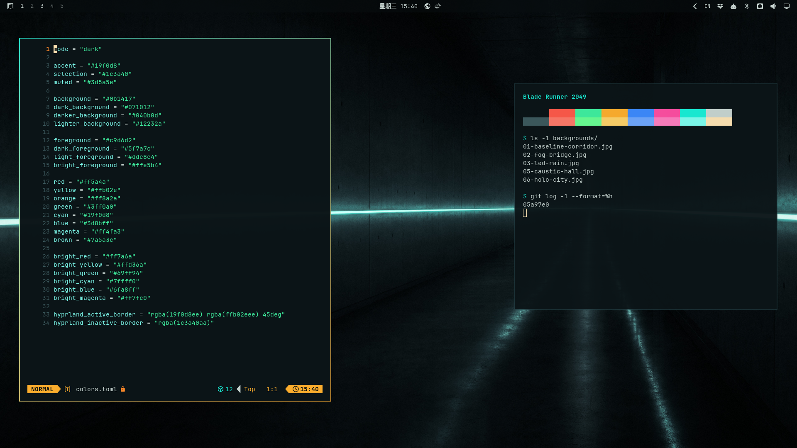

# Blade Runner 2049 for Omarchy

A dark, hazy theme for [Omarchy](https://omarchy.org/): carbon-teal surfaces, cyan as the data light, amber as the warning light, and a set of original cinematic wallpapers.



## Install

Run this on a machine with access to the repository.

```bash
omarchy theme install https://github.com/xsmJohnnyDepp/omarchy-blade-runner-2049-theme
```

Switch back any time with `omarchy theme set "Osaka Jade"` (or any other theme).

## What's inside

| File | Purpose |
|---|---|
| `colors.toml` | Palette. Omarchy generates the terminal, bar, lock screen, btop, Neovim and other app configs from it |
| `icons.theme` | `Yaru-prussiangreen-dark` |
| `backgrounds/` | Wallpapers, cycled with `omarchy theme bg next` |
| `preview.png` | Screenshot |

Palette highlights: background `#0b1417`, foreground `#c9d6d2`, accent cyan `#19f0d8`, amber `#ffb02e`, with a cyan-to-amber gradient on the active window border.

## Wallpapers

The wallpapers were generated by the theme author with OpenAI tools and color-graded for this theme. They are provided for download and use as desktop wallpapers with the theme. They contain no film stills, logos or text.

## License

The theme's palette and configuration files (`colors.toml` and `icons.theme`) are licensed under MIT. [MIT license](LICENSE)

The upstream copyright and MIT terms for the Lumon-derived Lua in earlier commits are preserved in the [third-party notices](THIRD-PARTY-NOTICES.md).

## Disclaimer

This is an unofficial fan theme. It is not affiliated with, endorsed by, or connected to the makers or rights holders of *Blade Runner 2049*.
